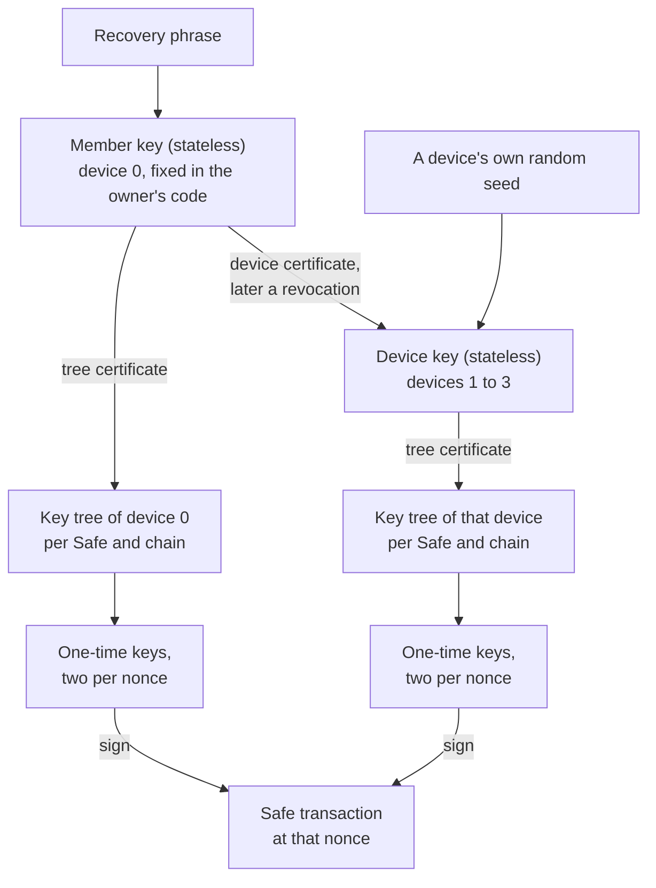

# Findings: hash-based signatures on today's Ethereum

**Winterlock is a working prototype of accounts controlled by hash-based signatures only: a Safe multisig, an ERC-4337 account and a native frame-transaction account. This page collects what building it showed, with the numbers.** It is written for people who build wallets, write standards or plan the move away from ECDSA.

Everything here ran on test networks, and nothing is audited. Each figure says how it was measured. The full record, with scripts, transactions and addresses, is in [decisions.md](decisions.md); [overview.md](overview.md) explains how Winterlock works. Links into the code point at commit [`3ef9eaf`][commit] of 2026-11-10, so the lines they name don't move.

## In short

| Question | What we found |
|---|---|
| What does one hash-based signature cost? | About 71k gas for an account to check a one-time signature, and about 99k with its calldata. ECDSA: about 7k. |
| And a single-signer account? | An ERC-4337 transfer costs 1.62× an ECDSA one on Arbitrum Sepolia, 1.34× on Sepolia under Glamsterdam. Three hosted bundlers accept the operations. |
| And a multisig? | A Safe 2-of-3 transfer costs 257,760 gas, against 65,794 with ECDSA owners. Each signing owner adds about 96k gas and 1.8 KB. |
| Does Safe have to change? | No. Its contracts, Transaction Service and app work as they are. Only message signatures over 5,000 bytes don't fit the service. |
| Do dapps work? | Transactions, sign-in and Permit2 work over WalletConnect, and viem accepts the signatures. Permits that accept only ECDSA can't work. |
| Can a wallet use one-time keys safely? | Yes, if each key is bound on-chain to one nonce and the signer records a key before it signs. Restores, moves, copies and two devices at one nonce were tested. |
| Can one key certify another? | Yes. A stateless key certifies key trees and device keys on-chain: 5.8 KB and about 0.25M gas each (0.39M on Sepolia). |
| Do native accounts (EIP-8141) work? | Yes. A transfer costs 102k gas with a one-time key. Its verification fits the public mempool's 100k cap; two signers would not. |
| How long does signing take? | Milliseconds on a laptop or in a browser. On an ESP32: 0.3 s for a one-time signature, 15 s for a stateless one. |
| What about SLH-DSA (FIPS 205)? | Verifying SLH-DSA-SHA2-128s costs 623k gas, about 755k with its calldata. |

## The two kinds of key

Every Winterlock account uses the same two keys, both over keccak:

- **One-time keys (WOTS)** sign transactions. A signature is 1,176 bytes plus 24 bytes per level of its key tree, and costs about 55k gas to verify. Parameters: 24-byte hashes, 48 chains, `w` = 16, digits that add up to 431, no checksum. Verifier: [`WotsVerifier.computeRoot`][wots-verifier]; signing: [`wots.rs`][core-wots].
- **A stateless key (leanSphincs-keccak)** certifies key trees and signs messages. A signature is 5,684 bytes and costs 52.8k gas to verify. Parameters: one tree layer of height 26, FORS with 24 trees of 1,024 leaves, WOTS+C with 64 chains (`w` = 4, target sum 120), 16-byte hashes. The [verifier][stateless-verifier] comes from Nicolas Consigny's SPHINCs-, vendored unchanged; signing: [`leansphincs.rs`][core-leansphincs].

The stateless key sets the account's security level, NIST category 1.

## Cost

The figures build up from one signature, to an account with one signer, to a multisig.

**One signature.** What an account pays to check one signature, in Foundry under Prague pricing, with the contract and its storage cold:

| Per signature | One-time key | Stateless key | ECDSA |
|---|---|---|---|
| Signature | 1,176 B + 24 B per tree level | 5,684 B | 65 B |
| The account's check | 71k (Safe owner, a transaction) | 69k (ERC-4337 validator) | about 6k |
| With calldata at 16 gas per byte | about 99k | about 161k | about 7k |

- **The hashing is about 55k gas of a one-time check and 52.8k of a stateless one.** The rest is the call into the contract and the signature copied with it.
- **Both keys cost about the same to verify.** What separates them is calldata: the stateless signature is three to four times as long.

**One signer: an ERC-4337 account.** A [validator][validator-validate] for ZeroDev's Kernel v3.3 checks the one-time signature. Gas per transfer, with each bundler's own estimates (validator as of 2026-11-05; scripts in [`bench/bundlers`][bench-bundlers]):

| Transfer on Kernel, one signer | Pimlico | Candide | Alchemy | Against ECDSA |
|---|---|---|---|---|
| ECDSA, Arbitrum Sepolia | 136,327 | 133,083 | 133,492 | 1.00× |
| One-time key, Arbitrum Sepolia | 221,563 | 215,951 | 216,384 | 1.62× |
| ECDSA, Sepolia (Glamsterdam) | | 241,703 | 238,581 | 1.00× |
| One-time key, Sepolia (Glamsterdam) | | 323,660 | 320,587 | 1.34× |

- **All three bundlers included every operation.**
- **One exception, not ours:** Alchemy rejects a counterfactual deployment through Kernel's meta factory, for ECDSA accounts too.
- **Pimlico charges more per signature byte** on Sepolia, which puts its ratio at 1.63×.
- **A native account** does the same transfer for 102k gas on an EIP-8141 test network: see [below](#a-native-account-eip-8141).

**A multisig: 2-of-3.** In a Safe, each member's owner is a [contract][owner] that checks the member's signature (EIP-1271); Safe counts k of n as usual. Foundry, Prague pricing, each call its own transaction, steady state ([test][test-gas-exec]):

| `execTransaction`, 2-of-3, Safe v1.4.1 | Gas | Against ECDSA |
|---|---|---|
| ETH transfer, ECDSA owners | 65,794 | 1.00× |
| ETH transfer, Winterlock owners | 257,760 | 3.9× |
| ERC-20 transfer, ECDSA owners | 72,586 | 1.00× |
| ERC-20 transfer, Winterlock owners | 264,491 | 3.6× |

- **A signing owner costs about 96k gas more than an ECDSA owner:** about 24k for its 1.8 KB of calldata, about 57k for the verification, and the rest for calling the owner and recomputing the transaction hash.
- **Live on Sepolia** (Glamsterdam pricing, gas from receipts), a 2-of-3 transfer took about 307k gas.
- **The same threshold inside one ERC-4337 account,** where the validator counts k of n itself, costs 307–315k gas on Arbitrum Sepolia across the three bundlers: 2.31× a single-signer ECDSA transfer on Kernel.

**Glamsterdam moves the cost from hashing to state.** Sepolia has run Glamsterdam since 2026-10-06.

- **The ratio to ECDSA falls,** from 1.62× to 1.34×: state access got dearer for every account, and hashing did not.
- **Deployments cost about seven times more.** The validator took 14.8M gas on Sepolia against 2.1M on Arbitrum Sepolia, close to the 16.7M transaction cap. The Safe owner's implementation took 11.4M against 1.6M under Prague.
- **New storage slots are where a hash-based account now pays:** the first operation on a new chain costs 381k gas more than ECDSA's.

**Parameters.**

- **`w` = 16 is cheapest** on L1 today, under EIP-7976's calldata floor, and on Base. `w` = 4 doubles the signature. `w` = 256 halves it but needs about 2,900 hash steps, and costs 3.7× ECDSA on Kernel.
- **keccak saves about 50k gas per signature** against SHA-256.
- **16-byte hashes** bring a single-signer transfer on Kernel down to 1.39× ECDSA (Arbitrum Sepolia), at category 1.

## Safe, unchanged

Safes of v1.4.1 with Winterlock owners, 2-of-2 and 2-of-3, ran end to end on Sepolia through Safe's hosted Transaction Service, with Safe's app showing the confirmations. What an owner contract has to know:

- **Safe raises its nonce before it checks signatures,** and the Transaction Service checks a confirmation with a call straight to the owner. So an owner can rely on neither the Safe's nonce nor `msg.sender`. Our signature carries the Safe's address and the transaction's fields; the owner [recomputes Safe's hash from them][owner-transaction] and takes the key index from the transaction's own nonce ([test][test-nonce-during]).
- **v1.4.1 and v1.5.0 call [different entry points][owner-1271]:** the legacy `isValidSignature(bytes, bytes)` with the 66-byte preimage, and `isValidSignature(bytes32, bytes)`.
- **The Transaction Service caps a confirmation at 5,000 bytes.** A transaction confirmation is 1,855 bytes and fits. A message signed by the stateless key is 5,835 bytes and doesn't.
- **A message signature can't approve a transaction.** Both are EIP-712 hashes in the Safe's domain, so the owner [recomputes which one it is][owner-message] and refuses a transaction hash signed as a message ([test][test-not-safetx]).
- **Anyone can execute.** An ordinary account that isn't an owner executed a confirmed transaction from Safe's app.
- **The [service][signer-service] keeps an owner's first confirmation.** After a device is revoked, its confirmation stays listed although it no longer verifies; the signer hands the new one to whoever executes.
- **Proposers (delegates) don't work:** the service registers them with a signature type the owner refuses by design.

## Messages and permits

A dapp on the official WalletConnect SDK asked a Safe of Winterlock owners for three things, through Reown's relay, and checked each answer with viem 2.57 against Sepolia ([dapp][live-dapp], [viem check][viem-verify]):

| Request | What the dapp got | Result |
|---|---|---|
| Sign-in (`personal_sign`) | two owners' stateless signatures, combined: 11,670 bytes, in 7 s | viem's `verifyMessage`: valid |
| Transaction (`eth_sendTransaction`) | the Safe transaction's hash, then the receipt once the members had confirmed | matches the chain |
| Permit2 (`eth_signTypedData_v4`) | 300 bytes naming the owners, after they approved the message on-chain | viem's `verifyTypedData`: valid |

- **Typed data that a contract will check is approved on-chain,** in an ordinary Safe transaction signed with one-time keys (Safe's SignMessageLib). That costs 265–267k gas, against 85–86k with ECDSA owners ([test][test-gas-approval]); live on Sepolia it took about 400k.
- **An empty signature isn't enough.** Safe's own convention answers the dapp with `0x` after such an approval. Permit2 and the `siwe` library accept that; viem refuses it, because its ERC-6492 check reverts on signatures under 32 bytes. So each owner got a [signature kind][owner-approved] that says "the Safe has approved this message", which no key signs; the signer [answers the dapp with it][signer-approved-answer].
- **An app's on-chain check** costs 44–51k gas for an approved message and 198–241k for two stateless signatures.
- **Permits that accept only ECDSA can't work,** for these owners or any smart account: EIP-2612 as OpenZeppelin's `ERC20Permit` implements it recovers an address from the signature ([test][test-consumers], with Permit2 next to it).
- **Safe's app doesn't reliably pass message results back to dapps,** so the signer answers them itself over [WalletConnect][signer-walletconnect]. The relay carried the 11.7 KB answer without trouble.

## One-time keys in a wallet

A one-time key that signs two different messages gives the account away. What kept that from happening:

- **Each key is bound on-chain to one account, one chain and one nonce:** the owner [takes the key's index from the nonce][owner-transaction] of the transaction it is checking. Once that nonce has executed, the key is useless, even to someone who holds several signatures from it ([test][test-other-nonce]).
- **[Two keys per nonce][owner-slots]:** one signs, the other is kept for a replacement or a cancellation at the same nonce ([test][test-slot1]). The signer [picks the slot][signer-pick-slot], never the user.
- **The signer [records a key before the signature leaves it][signer-keylog],** and [checks Safe's service][signer-stale] for signatures it doesn't know.
- **A [copied or rolled-back key log][signer-copy-check] signs nothing.** A copied browser profile refused to sign and named the confirmation it had found at Safe's service.
- **A lost device** is [restored][signer-restore] from the recovery phrase with fresh key trees, certified on-chain, so no old key is used again. A [move][signer-move] to a new device keeps the trees and locks the old device.
- **Two devices, one nonce:** on Daisugi, two devices of one member each signed a different transfer at the same nonce. The node took one and refused the other ([script][bench-daisugi-devices], step 4). Each device signs from its own tree, so no key signed twice ([test][test-same-nonce]).
- **Not protected:** a whole-machine rollback, such as a VM snapshot from before a move.

## One key certifying another

The stateless key from the recovery phrase, the member key, certifies everything else on-chain: key trees, and since owner v2 up to three device keys per member, which other devices make without the phrase.

What each certificate binds, and what the Safe owner keeps of it ([digests][owner-digests], [storage][owner-device-record]):

| Certificate | Signed by | It binds | The owner stores |
|---|---|---|---|
| Device certificate ([`certifyDevice`][owner-certify-device]) | the member key | chain, owner, device number, generation, the device's key | two words per device: its key; its generation and an active flag |
| Revocation ([`revokeDevice`][owner-revoke-device]) | the member key | chain, owner, device number, generation | the active flag, cleared; the generation stays |
| Tree certificate ([`enroll`][owner-enroll]) | the device's key; the member key for device 0 | chain, owner, Safe, device number, generation, the tree's root, height and first nonce | one word per Safe and device: root (24 bytes), generation, first nonce, height |

- **No certificate comes back.** A device certificate must carry the stored generation plus one, and within a generation a tree's first nonce only grows.
- **What a device signed counts only while it is active at that generation.** A transaction signature names its device; the owner [reads the device's tree][owner-transaction], compares the tree's generation with the device's state, and takes the key index from the nonce: (nonce − first nonce) × 2 + slot.
- **Revocation takes effect at once.** A device was revoked while a transaction it had confirmed was pending: its confirmation verified before the revocation and not after ([test][test-revoked]).
- **A table of four, not a root over the key set.** With four entries, a signature needs no membership proof, and each device replaces its trees without touching the others'. A revocation has to read current state either way.
- **Anyone may send a certificate;** only its signature counts. The signer [signs and sends it][signer-certify] from whatever holds the phrase.

What it costs:

| Step | Gas | Calldata |
|---|---|---|
| Certify a key tree in the ERC-4337 validator, with the first operation | 147,758 validation gas, against 65,335 without ([test][test-gas-certificate]) | 5,789 B |
| Certify a key tree for a Safe owner (`enroll`) | 251k (Foundry, Prague); 394k on Sepolia | 5,924 B |
| Certify a device key (`certifyDevice`) | 250,570; 392k on Sepolia | 5,860 B |
| Revoke a device key (`revokeDevice`) | 249,350; 388k on Sepolia | 5,828 B |
| In a frame account on Daisugi: add a device, revoke one | 46,513 and 7,010 for the call | |

- **Under Prague all three Safe steps sit at EIP-7623's calldata floor:** the 5.7 KB signature costs more than the execution ([test][test-gas-devices]).
- **A signature from a device key costs about 2k gas more** than one from the member's own key.
- **Each account takes the certificate another way:**
  - **The Safe owner** takes it in a transaction of its own. Safe checks owners with view calls, which can't store anything.
  - **The ERC-4337 validator** takes a tree certificate [inside the first operation's signature][validator-certificate] and stores the tree during validation. It has no device keys yet.
  - **The frame account** needs no separate certificate: the certifying key signs the transaction itself, and its frames [add the device or the tree][frame-manage]. The call is cheap, but the transaction carries that key's 5.7 KB signature and costs about 240k gas in all.

## A native account (EIP-8141)

The same keys guard a [frame-transaction account][frame-account] on Daisugi, a public test network that runs EIP-8141. Gas from receipts ([how it was run][bench-daisugi]):

| Transfer | Gas used | VERIFY frame | Signature |
|---|---|---|---|
| One-time key, tree of height 10 | 101,984 | 63,746 | 1,417 B |
| Stateless key | 239,570 | 59,909 | 5,684 B |
| A device's one-time key | 104,372 | 66,082 | |
| Daisugi's own SPHINCS account, for comparison | 468,001 | 353,919 | 6,176 B |

- **Both keys cost about the same to [verify][frame-verify].** The one-time key's transaction is 2.3× cheaper because its signature is a quarter of the size.
- **The public mempool's cap:** EIP-8141 lets a node refuse a transaction whose frames up to VERIFY reserve more than 100,000 gas. With the stateless key, [ours reserves 75,100][bench-daisugi-limits]; Daisugi itself doesn't enforce the cap. A transaction that also deploys the account reserves at least 135,100.
- **Two signers would not fit under the cap** at about 60k per verification. A k-of-n frame account is not built or measured.

## Signing times

| Operation | Laptop, native | Browser (WebAssembly) | ESP32, 240 MHz |
|---|---|---|---|
| One-time signature | 0.9 ms | 1.3–3.8 ms | 311 ms |
| Stateless signature | 60 ms | 41–87 ms | 15.3 s mean, 32.4 s worst of four |
| Stateless verification | 0.14 ms | | 40 ms |
| Key tree, height 10 (512 nonces) | 0.37 s | 0.42–0.49 s | 84 s on one core, 42 s on both |
| Member key | 0.10 s | 0.12–0.16 s | 23.3 s on one core, 11.7 s on both |

- **The laptop is a Ryzen 5 2600 under load,** one thread ([benchmark][speed-native]); the browser is headless Chromium on the same machine ([benchmark][speed-browser]).
- **The ESP32 hashes in software:** 9,464 keccak hashes per second. It computes the same bytes as the other two: all 54 checks pass ([what it checks][esp32-check], [the run's log][esp32-log]).
- **These are our stateless key's parameters,** not those of leanVM's leanSPHINCS, which has three tree layers.
- **Not measured:** phones, and secure elements. From a published figure of 1.5 ms per keccak hash on a Ledger Nano S+, a stateless signature would take 1.5–2.5 minutes there (an estimate).

## SLH-DSA on the EVM

What would it cost to verify the NIST standard itself? We wrote a [verifier][slh-dsa-verifier] for SLH-DSA-SHA2-128s over the SHA-256 precompile and checked it against 56 NIST ACVP cases and two independent libraries ([benchmark and method][bench-slh-dsa]).

| Per signature, Prague | SLH-DSA-SHA2-128s | leanSphincs-keccak | One-time key | ECDSA |
|---|---|---|---|---|
| Signature | 7,856 B | 5,684 B | 1,176 B + path | 65 B |
| An owner's check | 629k (596k–667k) | 69k | 71k | about 6k |
| With calldata at 16 gas per byte | about 755k | about 161k | about 99k | about 7k |

- **About 2,125 calls of the SHA-256 precompile** per verification, at about 246 gas each. A Keccak-f permutation in leanSphincs-keccak costs about 147.
- **Gas varies by about ±40k between signatures of one key,** so a wallet has to estimate with the real signature.
- **Signing** takes 0.22 s natively and 1.1–1.3 s in WebAssembly.
- **The draft set SLH-DSA-SHA2-128-24** (NIST SP 800-230) verifies for about 173k gas with calldata, but a key and its first signature take about 1.45 billion hashes.

## What this doesn't show

- **No audit, and no real funds.** The contracts and signers are research prototypes.
- **No mainnet figures.** Gas is from Foundry under Prague pricing, or from receipts on Sepolia, Arbitrum Sepolia and Daisugi, as each table says.
- **No hardware wallet.** The ESP32 run shows the code and the timings on a microcontroller, not a secure element.
- **Category 1 only.** A stateless key with 24-byte hashes would raise the whole account to category 3; not built.

## Related

- The way a recovery phrase becomes these keys is proposed as a standard: [ERC-8499, Hash-Based Key Derivation from BIP-39](https://github.com/ethereum/ERCs/pull/2172) (draft). The signer app follows it since 14 November 2026 ([decisions.md](decisions.md), D15); the command-line signer keeps its earlier derivation.
- [decisions.md](decisions.md): every decision and measurement, in order.
- Notes on [messages](notes/safe-messages.md), [WalletConnect](notes/walletconnect.md), [recovery](notes/signer-recovery.md) and [owner v2](notes/owner-v2.md), which has the full design of device keys.

<!-- code links, pinned to one commit (generated; see the commit named above) -->
[commit]: https://github.com/johba37/winterlock.eth/tree/3ef9eafa4f8053ff44e4527af16597a3bebfced9
[wots-verifier]: https://github.com/johba37/winterlock.eth/blob/3ef9eafa4f8053ff44e4527af16597a3bebfced9/contracts/src/WotsVerifier.sol#L101-L116
[stateless-verifier]: https://github.com/johba37/winterlock.eth/blob/3ef9eafa4f8053ff44e4527af16597a3bebfced9/contracts/src/vendor/sphincs-minus/LeanSphincsAsm.sol#L113
[core-wots]: https://github.com/johba37/winterlock.eth/blob/3ef9eafa4f8053ff44e4527af16597a3bebfced9/core/src/wots.rs
[core-leansphincs]: https://github.com/johba37/winterlock.eth/blob/3ef9eafa4f8053ff44e4527af16597a3bebfced9/core/src/leansphincs.rs
[owner]: https://github.com/johba37/winterlock.eth/blob/3ef9eafa4f8053ff44e4527af16597a3bebfced9/contracts/src/safe/WinterlockOwner.sol
[owner-slots]: https://github.com/johba37/winterlock.eth/blob/3ef9eafa4f8053ff44e4527af16597a3bebfced9/contracts/src/safe/WinterlockOwner.sol#L98-L99
[owner-digests]: https://github.com/johba37/winterlock.eth/blob/3ef9eafa4f8053ff44e4527af16597a3bebfced9/contracts/src/safe/WinterlockOwner.sol#L248-L290
[owner-device-record]: https://github.com/johba37/winterlock.eth/blob/3ef9eafa4f8053ff44e4527af16597a3bebfced9/contracts/src/safe/WinterlockOwner.sol#L167-L177
[owner-certify-device]: https://github.com/johba37/winterlock.eth/blob/3ef9eafa4f8053ff44e4527af16597a3bebfced9/contracts/src/safe/WinterlockOwner.sol#L298-L311
[owner-revoke-device]: https://github.com/johba37/winterlock.eth/blob/3ef9eafa4f8053ff44e4527af16597a3bebfced9/contracts/src/safe/WinterlockOwner.sol#L316-L325
[owner-enroll]: https://github.com/johba37/winterlock.eth/blob/3ef9eafa4f8053ff44e4527af16597a3bebfced9/contracts/src/safe/WinterlockOwner.sol#L334-L358
[owner-1271]: https://github.com/johba37/winterlock.eth/blob/3ef9eafa4f8053ff44e4527af16597a3bebfced9/contracts/src/safe/WinterlockOwner.sol#L362-L370
[owner-transaction]: https://github.com/johba37/winterlock.eth/blob/3ef9eafa4f8053ff44e4527af16597a3bebfced9/contracts/src/safe/WinterlockOwner.sol#L385-L400
[owner-message]: https://github.com/johba37/winterlock.eth/blob/3ef9eafa4f8053ff44e4527af16597a3bebfced9/contracts/src/safe/WinterlockOwner.sol#L437-L442
[owner-approved]: https://github.com/johba37/winterlock.eth/blob/3ef9eafa4f8053ff44e4527af16597a3bebfced9/contracts/src/safe/WinterlockOwner.sol#L446-L461
[validator-validate]: https://github.com/johba37/winterlock.eth/blob/3ef9eafa4f8053ff44e4527af16597a3bebfced9/contracts/src/WinterlockValidator.sol#L243-L267
[validator-certificate]: https://github.com/johba37/winterlock.eth/blob/3ef9eafa4f8053ff44e4527af16597a3bebfced9/contracts/src/WinterlockValidator.sol#L304-L319
[frame-account]: https://github.com/johba37/winterlock.eth/blob/3ef9eafa4f8053ff44e4527af16597a3bebfced9/contracts/frame/WinterlockFrameAccountV2.yul
[frame-verify]: https://github.com/johba37/winterlock.eth/blob/3ef9eafa4f8053ff44e4527af16597a3bebfced9/contracts/frame/WinterlockFrameAccountV2.yul#L51-L73
[frame-manage]: https://github.com/johba37/winterlock.eth/blob/3ef9eafa4f8053ff44e4527af16597a3bebfced9/contracts/frame/WinterlockFrameAccountV2.yul#L151-L215
[test-gas-exec]: https://github.com/johba37/winterlock.eth/blob/3ef9eafa4f8053ff44e4527af16597a3bebfced9/contracts/test/integration/SafeWinterlockOwner.t.sol#L693-L714
[test-gas-devices]: https://github.com/johba37/winterlock.eth/blob/3ef9eafa4f8053ff44e4527af16597a3bebfced9/contracts/test/integration/SafeWinterlockOwner.t.sol#L925-L933
[test-nonce-during]: https://github.com/johba37/winterlock.eth/blob/3ef9eafa4f8053ff44e4527af16597a3bebfced9/contracts/test/integration/SafeWinterlockOwner.t.sol#L242-L255
[test-slot1]: https://github.com/johba37/winterlock.eth/blob/3ef9eafa4f8053ff44e4527af16597a3bebfced9/contracts/test/integration/SafeWinterlockOwner.t.sol#L298-L310
[test-other-nonce]: https://github.com/johba37/winterlock.eth/blob/3ef9eafa4f8053ff44e4527af16597a3bebfced9/contracts/test/integration/SafeWinterlockOwner.t.sol#L314-L337
[test-same-nonce]: https://github.com/johba37/winterlock.eth/blob/3ef9eafa4f8053ff44e4527af16597a3bebfced9/contracts/test/integration/SafeWinterlockOwner.t.sol#L548-L571
[test-revoked]: https://github.com/johba37/winterlock.eth/blob/3ef9eafa4f8053ff44e4527af16597a3bebfced9/contracts/test/integration/SafeWinterlockOwner.t.sol#L577-L605
[test-not-safetx]: https://github.com/johba37/winterlock.eth/blob/3ef9eafa4f8053ff44e4527af16597a3bebfced9/contracts/test/integration/SafeMessages.t.sol#L401-L423
[test-consumers]: https://github.com/johba37/winterlock.eth/blob/3ef9eafa4f8053ff44e4527af16597a3bebfced9/contracts/test/integration/SafeMessages.t.sol#L470-L505
[test-gas-approval]: https://github.com/johba37/winterlock.eth/blob/3ef9eafa4f8053ff44e4527af16597a3bebfced9/contracts/test/integration/SafeMessages.t.sol#L639-L664
[test-gas-certificate]: https://github.com/johba37/winterlock.eth/blob/3ef9eafa4f8053ff44e4527af16597a3bebfced9/contracts/test/WinterlockCertificates.t.sol#L404-L415
[bench-bundlers]: https://github.com/johba37/winterlock.eth/tree/3ef9eafa4f8053ff44e4527af16597a3bebfced9/contracts/bench/bundlers
[bench-daisugi]: https://github.com/johba37/winterlock.eth/blob/3ef9eafa4f8053ff44e4527af16597a3bebfced9/contracts/bench/daisugi/README.md
[bench-daisugi-limits]: https://github.com/johba37/winterlock.eth/blob/3ef9eafa4f8053ff44e4527af16597a3bebfced9/contracts/bench/daisugi/README.md#limits-the-node-enforces
[bench-daisugi-devices]: https://github.com/johba37/winterlock.eth/blob/3ef9eafa4f8053ff44e4527af16597a3bebfced9/contracts/bench/daisugi/devices.py#L255-L370
[bench-slh-dsa]: https://github.com/johba37/winterlock.eth/blob/3ef9eafa4f8053ff44e4527af16597a3bebfced9/contracts/bench/slh-dsa/README.md
[slh-dsa-verifier]: https://github.com/johba37/winterlock.eth/blob/3ef9eafa4f8053ff44e4527af16597a3bebfced9/contracts/bench/slh-dsa/src/SlhDsaSha2_128s.sol
[signer-keylog]: https://github.com/johba37/winterlock.eth/blob/3ef9eafa4f8053ff44e4527af16597a3bebfced9/signer/winterlock_signer/keylog.py#L204-L215
[signer-pick-slot]: https://github.com/johba37/winterlock.eth/blob/3ef9eafa4f8053ff44e4527af16597a3bebfced9/signer/winterlock_signer/keylog.py#L187-L202
[signer-copy-check]: https://github.com/johba37/winterlock.eth/blob/3ef9eafa4f8053ff44e4527af16597a3bebfced9/signer/winterlock_signer/device.py#L119-L144
[signer-stale]: https://github.com/johba37/winterlock.eth/blob/3ef9eafa4f8053ff44e4527af16597a3bebfced9/signer/winterlock_signer/cli.py#L261-L293
[signer-restore]: https://github.com/johba37/winterlock.eth/blob/3ef9eafa4f8053ff44e4527af16597a3bebfced9/signer/winterlock_signer/cli_recovery.py#L230-L261
[signer-move]: https://github.com/johba37/winterlock.eth/blob/3ef9eafa4f8053ff44e4527af16597a3bebfced9/signer/winterlock_signer/move.py
[signer-service]: https://github.com/johba37/winterlock.eth/blob/3ef9eafa4f8053ff44e4527af16597a3bebfced9/signer/winterlock_signer/service.py
[signer-approved-answer]: https://github.com/johba37/winterlock.eth/blob/3ef9eafa4f8053ff44e4527af16597a3bebfced9/signer/winterlock_signer/messages.py#L474-L489
[signer-walletconnect]: https://github.com/johba37/winterlock.eth/blob/3ef9eafa4f8053ff44e4527af16597a3bebfced9/signer/winterlock_signer/walletconnect.py
[signer-certify]: https://github.com/johba37/winterlock.eth/blob/3ef9eafa4f8053ff44e4527af16597a3bebfced9/signer/winterlock_signer/cli_devices.py#L167-L208
[viem-verify]: https://github.com/johba37/winterlock.eth/blob/3ef9eafa4f8053ff44e4527af16597a3bebfced9/signer/tests/viem_verify.js
[live-dapp]: https://github.com/johba37/winterlock.eth/blob/3ef9eafa4f8053ff44e4527af16597a3bebfced9/signer/tools/live_dapp.js
[speed-native]: https://github.com/johba37/winterlock.eth/blob/3ef9eafa4f8053ff44e4527af16597a3bebfced9/core/examples/speed.rs
[speed-browser]: https://github.com/johba37/winterlock.eth/blob/3ef9eafa4f8053ff44e4527af16597a3bebfced9/app/src/bench.ts
[esp32-check]: https://github.com/johba37/winterlock.eth/blob/3ef9eafa4f8053ff44e4527af16597a3bebfced9/hardware/esp32-core-check/README.md
[esp32-log]: https://github.com/johba37/winterlock.eth/blob/3ef9eafa4f8053ff44e4527af16597a3bebfced9/hardware/esp32-core-check/runs/2026-11-10-esp32-v1.0.log
