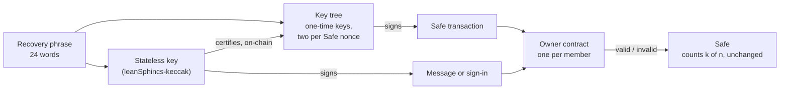

# Winterlock in one page

**Winterlock lets a team's Safe be controlled by hash-based signatures instead of ECDSA, with the Safe, Safe's app and dapps working as before.** Hash-based signatures are the kind a quantum computer can't break.

Every Ethereum account today rests on ECDSA, which a large quantum computer would break. The protocol can fix its own signatures in a hard fork, but it can't swap your keys for you: each team has to move funds or change owners itself, and that takes time. Hash-based signatures rest only on the security of a hash function, the most conservative assumption on offer.

## How it works

- **Each member has a recovery phrase.** From it, the member's signer derives two kinds of key:
  - **A stateless key** (leanSphincs-keccak) can sign many times. It certifies key trees and signs messages. Its signature is 5.7 KB.
  - **Key trees** of one-time keys (WOTS) sign transactions. Their signature is 1.2 KB plus a short proof that the key belongs to the tree, and it's cheaper to check.
- **One owner contract per member is listed in the Safe as that member's owner.** When the Safe checks signatures, it asks the owner contract, which verifies the hash-based signature (EIP-1271).
  - The owner contract is a 77-byte proxy, and its address follows from the stateless key, so it's the same on every chain.
- **A key tree covers a range of Safe nonces.** Each nonce has its own keys, so a key signs for one nonce only, and once that nonce has executed, its key is useless.
  - The stateless key certifies each tree on-chain.
  - A fresh tree takes over before the old one runs out. The default tree covers 512 nonces.
- **Safe's contracts, Transaction Service and web app are unchanged.** Members sign with the Winterlock signer. Anyone can execute, including from Safe's app.
- **Owner v2 (live on Sepolia since 2026-11-06) adds device keys.** The stateless key from the phrase becomes the member key. It certifies, on each chain, up to three device keys that a member's other devices make without the phrase, and revokes a lost one. Each device keeps its own key trees, so the phrase can stay offline while laptops and phones sign.

## Numbers

| Safe v1.4.1, 2-of-3 | Winterlock owners | ECDSA owners |
|---|---|---|
| Signature per owner | about 1.8 KB | 65 bytes |
| ETH transfer | 247k gas | 66k gas |
| Extra per signing owner | about +90k gas | — |
| One-time, per member and chain | about 0.6M gas (owner and first key tree, on Sepolia) | — |
| One-time, per chain | about 20M gas on Sepolia for the shared contracts (stateless verifier, owner implementation, factory), deployed once for everyone | — |

Checking one one-time signature costs about 55k gas, and a stateless signature 52.8k. Gas figures are from Foundry under Prague pricing, unless they name Sepolia. Details are in [decisions.md](decisions.md).

These are v1's numbers. **Owner v2** costs about 7k more per 2-of-3 transaction (WOTS verification moved into a shared contract to keep the owner's code deployable), and about 2k more per signature from a device key. Certifying or revoking a device key costs about 0.25M gas per chain, 0.39M on Sepolia. Its shared contracts took 19.5M gas once on Sepolia, on top of the stateless verifier it shares with v1.

## Live on Sepolia

- **Safe:** Safe v1.4.1 Safes with Winterlock owners work end to end through Safe's hosted Transaction Service.
  - Members propose, confirm and execute with the signer.
  - Safe's app shows the confirmations.
  - An account that isn't an owner executed a confirmed transaction from Safe's app with MetaMask.
- **Dapps over WalletConnect,** through Reown's relay:
  - **A real dapp,** Reown's AppKit lab: transactions, sign message, sign typed data.
  - **A dapp on the official SDK:** a sign-in signature that viem verifies on-chain, transactions with receipts, and Permit2.
- **The signer:**
  - a recovery phrase and an encrypted seed
  - a key log saved to disk before any signature leaves it
  - moving to a new device
  - restoring after a lost device, after which the old device can no longer undo the restore
  - a newcomer followed the README from scratch to a working 2-of-3 Safe
- **Owner v2,** on a 2-of-2 test Safe of v2 owners (shared contracts on Sepolia: WOTS verifier `0x272138c7D3b508bd510bE5166fbE2461561e410D`, implementation `0x114caAB223BaccD9BcA92C28ABBCf1edC0C3bCdf`, factory `0x90835a46Fb205B7f038B0EE46e798ead45a6fA7F`; the stateless verifier `0x6Dc4DFBccDe0fbeC30b0a4078aB6f45496Fec254` is shared with v1):
  - a member paired a device key and signed from it, without the phrase
  - the device was revoked while a transaction it had confirmed was pending: its confirmation stopped counting at once, and the member confirmed again from the phrase's home. Safe's service keeps an owner's first confirmation, so the signer hands the new one to whoever executes in a proposal file.
  - a dapp on the official SDK got a Permit2 permit answered with the owners' approved signatures, and viem's `verifyTypedData` accepted it
  - v1's contracts stay deployed and keep working; the earlier test Safes still have v1 owners
- **For individuals: a Kernel (ERC-7579) validator** with built-in k-of-n. An earlier version ran live with the same address on Ethereum Sepolia and Arbitrum Sepolia. Pimlico, Candide and Alchemy accepted its operations.

## Security, briefly

- **Hash functions only** (keccak). No ECDSA key controls the account.
- **One-time keys can't be silently reused.**
  - Keys are tied to Safe nonces, so a reused key could only matter for a nonce that hasn't executed yet.
  - The signer saves its key log before releasing a signature.
  - It refuses copied or rolled-back key logs.
  - It checks Safe's service for signatures it doesn't know.
- **Strength:** NIST category 1 overall, set by the stateless key's 16-byte hashes. The one-time keys use 24-byte hashes.
- **Not audited.** Testnet only.
- **Found a vulnerability?** Report it privately: see [SECURITY.md](../SECURITY.md).

## Not yet

- **Moving the earlier test Safes to owner v2.** Each member swaps their v1 owner for their v2 owner in a Safe transaction; not done yet.
- **A hardware signer.** Hashing speed on secure elements needs measuring first.
- **An audit.**
- **Frame transactions (EIP-8141).** The same keys and signer would fit a native account. Not built yet.
- **A key that EIP-8288 can check.** EIP-8288 would check a leanSPHINCS signature off-chain for about 33,000 gas: 3,000 for its frame and 30,000 for its share of the block's proof. It checks leanVM's version of leanSPHINCS, not ours. leanVM runs on keccak too, but with other parameters (three layers, FIPS 205 addresses, another target sum), so the same seed gives another public key. leanVM calls its hash a placeholder; SHA2, BLAKE2s and BLAKE3 are being considered. A second stateless key in leanVM's version, derived from the same recovery phrase and certified by today's key, would let members move without a new backup. Nothing to build until leanVM fixes its hash and parameters.

## Terms

- **Member:** a person on the team.
- **Signer:** the Winterlock program on the member's device.
- **Owner:** the member's owner contract, the address listed in the Safe.
- **Stateless key:** a leanSphincs-keccak key: the keccak version of leanSPHINCS, since keccak is the hash the EVM computes cheaply. It certifies key trees and signs messages. "leanSPHINCS" on its own, as in EIP-8288, means leanVM's version, which also runs on keccak for now but has other parameters and other public keys.
- **Member key:** the member's stateless key from the recovery phrase, fixed in the owner contract (device 0). It is the way back after a lost device, and in owner v2 it certifies and revokes device keys.
- **Device key (owner v2):** a stateless key that one of the member's devices makes from its own random seed, without the phrase, certified on-chain by the member key on each chain. It certifies that device's key trees and signs messages, until it is revoked. A member has at most three.
- **Device home:** the signer's directory on such a device: its device key, its own key log, no phrase.
- **Key tree:** one-time keys for a range of Safe nonces, certified on-chain.
- **Key log:** the signer's record of which one-time keys it has used.
- **Gas account:** any funded account that pays for enrolling and executing. It isn't an owner.

## Where next

- [README](../README.md): set up the signer and try it on Sepolia.
- [decisions.md](decisions.md): every decision and measurement, in order.
- Notes on [messages](notes/safe-messages.md), [WalletConnect](notes/walletconnect.md) and [recovery](notes/signer-recovery.md).
